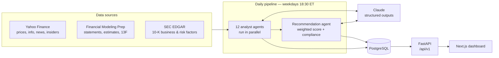
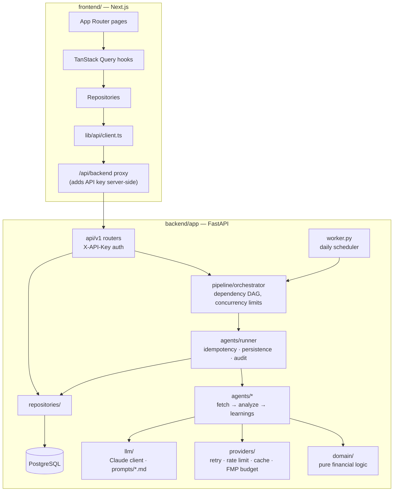

# agentsForStocks

[](https://github.com/amirge118/agentsForStocks/actions/workflows/ci.yml)

**A multi-agent stock analysis system.** Thirteen specialised AI agents analyse
each stock on a watchlist every trading day: fundamentals, valuation, moat, risk,
growth, earnings, institutional flows, sentiment, technicals and more. A final
recommendation agent then combines their signals into a weighted
**BUY / HOLD / SELL** call. Results are stored in PostgreSQL, exposed through an
authenticated REST API and shown on a Next.js dashboard.

> ⚠️ **Not investment advice.** This is an automated research tool. Every
> recommendation passes a rule-based compliance review and carries a disclaimer.

---

## Contents

- [How it works](#how-it-works)
- [The agents](#the-agents)
- [Tech stack](#tech-stack)
- [Architecture](#architecture)
- [Getting started](#getting-started)
- [Operations](#operations)
- [Project structure](#project-structure)
- [Roadmap](#roadmap)

---

## How it works



1. **Fetch.** Each agent pulls its data through rate-limited, cached, retrying
   provider clients (Yahoo Finance, FMP, SEC EDGAR).
2. **Compute.** Agents run deterministic financial logic: DCF, owner earnings,
   EV/EBITDA, CAGRs, five technical strategies, beat rates, insider buy rates and so on.
3. **Judge.** Claude reviews the computed metrics and returns a typed
   `signal / confidence / reasoning`, enforced by a JSON schema. If Claude is
   unavailable, the agent keeps its own quantitative signal.
4. **Store.** Results are upserted per *(agent, symbol, market date)*. Re-runs are
   idempotent, and every execution, failures included, is logged in an audit table.
5. **Recommend.** Once its eight weighted inputs have finished, the
   recommendation agent produces the final call. A high-confidence bearish risk
   signal caps a bullish call at HOLD, and promissory language ("guaranteed",
   "risk-free") is rejected and replaced.

---

## The agents

| Agent | What it analyses | Weight | Sources |
|---|---|---:|---|
| `financial_history` | Five-year revenue, profit, cash-flow and balance-sheet trends, CAGRs | **20** | FMP |
| `valuation` | Intrinsic value: three-scenario DCF, owner earnings, sector EV/EBITDA → margin of safety | **20** | Yahoo, FMP |
| `moat` | Brand, IP, switching costs, network effects, margin durability | **15** | SEC 10-K, FMP |
| `risk` | 10-K risk factors, leverage, liquidity, beta | **15** | SEC 10-K, FMP, Yahoo |
| `broad_analysis` | Business quality and competitive position | **10** | FMP, SEC 10-K |
| `growth` | Management commentary in earnings calls + forward analyst estimates | **10** | FMP |
| `institutional` | Smart-money accumulation / distribution from 13F filings | **5** | FMP, Yahoo |
| `earnings` | Beat rate, surprise size, 1- and 3-day post-earnings reaction | **5** | FMP, Yahoo |
| `fundamentals` | Profitability, growth, financial health, valuation, by majority vote | info | Yahoo |
| `technicals` | Trend, mean reversion, momentum, volatility, statistical arbitrage | info | Yahoo |
| `sentiment` | Insider trades (30%) + Claude-classified news headlines (70%) | info | Yahoo |
| `market_scanner` | End-of-day price action, SMA position, volume spikes | info | Yahoo |
| `recommendation` | Weighted **BUY / HOLD / SELL** (BUY > +15, SELL < −15) | — | the 8 weighted agents |

The weights total 100 and are declared once, on each agent's registration. Adding
an agent means one new file with `@register_agent(...)`. The scheduler and the
execution order are derived from the registry's dependency graph.

---

## Tech stack

### Backend (Python 3.13)
| Area | Technology |
|---|---|
| Web API | **FastAPI** 0.162 · Starlette 1.10 · Uvicorn |
| Database | **PostgreSQL 16** · SQLAlchemy 2.0 (async) · asyncpg · **Alembic** migrations |
| AI | **Anthropic Claude** (`anthropic` SDK) with structured outputs; Haiku for agent judgements, Sonnet for the final recommendation (configurable) |
| Market data | **yfinance**, Financial Modeling Prep REST API, SEC EDGAR REST API (via `httpx`) |
| Analysis | pandas, NumPy |
| Scheduling | APScheduler (in-process for development, dedicated worker process in production) |
| Config | pydantic-settings (environment variables / `.env`) |
| Optional | OpenViking knowledge layer (agent memory of recurring patterns), MCP connector for FactSet / S&P Global / Morningstar / Daloopa |

### Frontend
| Area | Technology |
|---|---|
| Framework | **Next.js 15** (App Router) · **React 19** · TypeScript (strict) |
| Data | **TanStack Query v5** · **Zod** runtime validation |
| UI | Tailwind CSS (dark theme) · shadcn/ui primitives (Radix) |
| API contract | Types generated from the backend's OpenAPI with `openapi-typescript`, checked against the Zod schemas at compile time |

---

## Architecture



Design principles:

- **Agents only describe *what* to analyse.** The cross-cutting rules
  (idempotency, logging, persistence, error handling) live once in `AgentRunner`.
- **`domain/` is pure.** No I/O, no LLM and no database, just the financial logic.
- **One composition root.** `app/container.py` wires every dependency, and tests
  swap in fakes.
- **Every external call goes through `providers/`**, with exponential-backoff
  retry on transient errors only, per-domain rate limits, a shared TTL cache
  with in-flight de-duplication, and a daily FMP call budget (free tier: 250 calls/day).

---

## Getting started

### Option 1 — Docker (whole stack)

```bash
git clone https://github.com/amirge118/agentsForStocks.git
cd agentsForStocks
cp .env.example .env    # set API_KEYS, BACKEND_API_KEY, DASHBOARD_PASSWORD (+ Anthropic / FMP keys)
docker compose up --build
```

This starts PostgreSQL, runs the migrations, and brings up the API
(`localhost:8000`), the scheduler worker and the dashboard (`localhost:3000`).

### Option 2 — Local development

Python 3.13, Node.js 22 and Docker (for PostgreSQL).

```bash
git clone https://github.com/amirge118/agentsForStocks.git
cd agentsForStocks
cp .env.example .env              # fill in the keys you have

# Database
docker compose up -d db

# Backend
cd backend
pip install -r requirements-dev.txt
alembic upgrade head
python -m scripts.preflight       # checks keys + connectivity, exit 1 = not ready
uvicorn app.main:app --reload     # http://localhost:8000  (docs: /docs)

# Frontend (new terminal)
cd frontend
cp .env.example .env.local
npm install
npm run dev                       # http://localhost:3000
```

Run the pipeline once, right away, instead of waiting for the daily schedule:

```bash
cd backend
python -m scripts.run_pipeline AAPL MSFT                    # all agents
python -m scripts.run_pipeline AAPL --agents technicals valuation --force
```

---

## Operations

| Task | Command (from `backend/`) |
|---|---|
| Check readiness (DB, Claude, FMP, Yahoo, SEC) | `python -m scripts.preflight` |
| Run the pipeline now | `python -m scripts.run_pipeline AAPL [--agents …] [--force]` |
| Tokens and cost per agent / model / day | `python -m scripts.token_report [--days 30] [--by model]` — also on the dashboard's **Tokens & cost** page |
| Production scheduler | API with `RUN_SCHEDULER=false` + **one** `python -m app.worker` (the `worker` service in Docker Compose) |
| Migrations | `alembic upgrade head` |
| Export the API contract for the frontend | `python -m scripts.export_openapi`, then `npm run generate:api` in `frontend/` |

---

## Project structure

```
backend/
  app/
    agents/        one file per agent + base, runner, registry, catalog, scheduler
    pipeline/      orchestrator (dependency DAG) + background launcher
    domain/        pure financial logic: valuation, technicals, scoring, compliance, …
    providers/     yfinance / FMP / EDGAR clients + http, retry, rate limit, cache
    llm/           Claude client, MCP servers, prompts/<agent>.md
    knowledge/     OpenViking store + null implementation
    repositories/  all SQL
    api/           auth + v1 routers
    ops/           preflight + manual-run reporting
    container.py   composition root      worker.py   scheduler process
  alembic/         migrations
  scripts/         preflight, run_pipeline, export_openapi
  tests/           unit/ + integration/
frontend/
  src/app/         pages + the /api/backend proxy
  src/components/  features/ (dashboard, stocks, agents) + ui/ (shadcn)
  src/lib/         api client, repositories, hooks, formatting, auth
  src/types/       generated OpenAPI types + Zod schemas
  e2e/             Playwright specs
infra/openviking/  knowledge-layer config, seed resources and analysis skills
```

Contributor conventions (layers, testing, commit format) are in
[`CLAUDE.md`](CLAUDE.md).

---

## Roadmap

Tracked in [`FUTURE_IMPROVEMENTS.md`](FUTURE_IMPROVEMENTS.md). Highlights:

- First live run against Claude, FMP, Yahoo and SEC, then backtest the
  recommendation weights and thresholds against historical prices.
- Portfolio-level agents (portfolio health, portfolio manager) building on the
  existing position-sizing logic.
- Licensed data sources (Daloopa, S&P Global, Morningstar) through the MCP connector.
- Richer dashboard: per-agent panels, score and price history charts.
- Deployment: publish images and add a release workflow.
